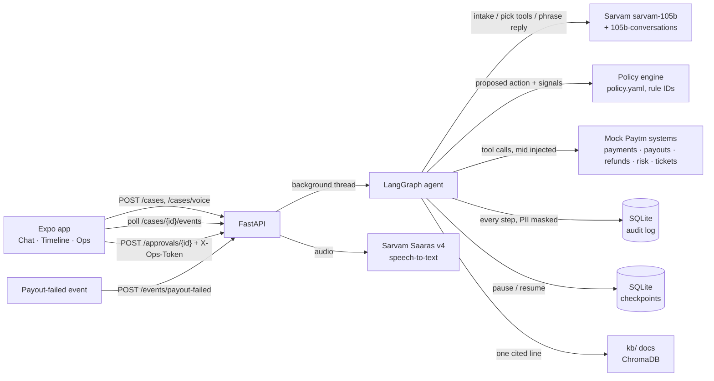
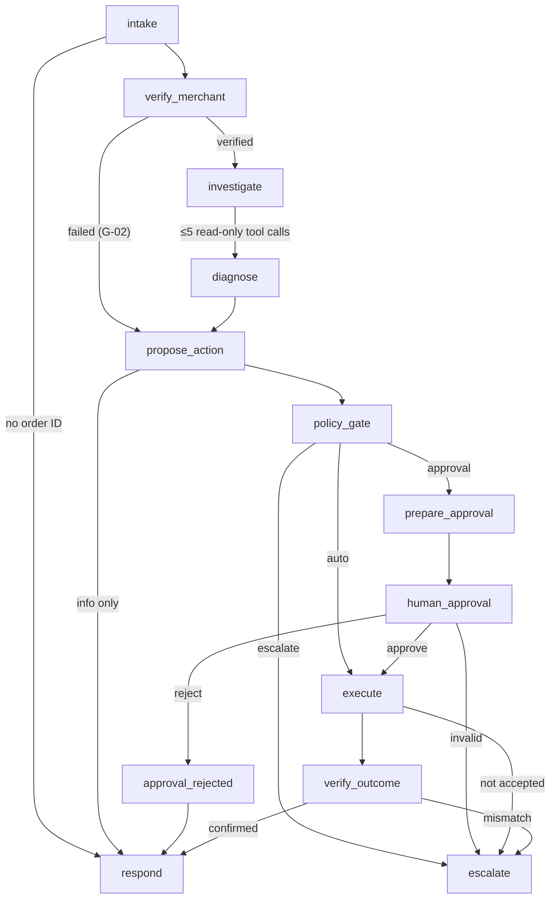

# Merchant Success AI

An AI teammate that **closes** merchant payment cases end to end: it hears the complaint (Tamil or
English, text or voice), verifies the merchant, investigates across payment systems, diagnoses the
root cause, fixes it when policy allows, confirms the fix by re-reading the system, and hands off to
a human when it must.

Paytm Build for India AI Hackathon, Track 3 (Autonomous AI Teammates).
**All data and systems are synthetic mocks. Nothing here calls real Paytm APIs.**

> The LLM proposes, the policy engine decides, the verifier confirms.

## Architecture



### The agent graph



The LLM is used in only three places: **intake** (regex and Tamil-script detection override it),
**investigate** (picks read-only tools; code then guarantees the minimum evidence) and **respond**
(rephrases a template with `{placeholders}`; code fills real values; a validator can veto).
Diagnosis, proposals, policy, execution and verification are plain Python.

## Guardrails

| Guardrail | Where |
|---|---|
| LLM never chooses whose data it reads: tool schemas have no `mid`, the wrapper injects the verified one | `app/agent/tools.py` |
| Ownership check on every tool; another merchant's record reveals nothing | `app/mock_systems.py` |
| Identity: exactly 4 digits, lock after 3 wrong tries; no investigation before verification | `mock_systems.py`, graph |
| Idempotency keys on every money move; reused key for a different request rejected | `mock_systems.py` |
| Refunds positive and capped at what the customer paid, across cases | `mock_systems.py` |
| Deterministic policy with rule IDs; unknown action / no match / bad amount → escalate | `app/policy_engine.py` |
| Refund rules require the `duplicate_verified` evidence signal (set by code, not the LLM) | `policy/policy.yaml` |
| Amount limits: refunds auto ≤ ₹5,000 (R-21), Ops ≤ ₹1,00,000 (R-22), else escalate (R-23); payout retries auto ≤ ₹50,000 (R-07), Ops above (R-10) | `policy/policy.yaml` |
| Read-after-write verification; mismatch → escalate | `verify_outcome` |
| Reply validator: right language script, no number or ID that isn't in evidence | `app/agent/replies.py` |
| Approval bound to a hash of the evidence pack; re-checked against current state on resume | `human_approval` |
| Case 4: no refund without the payer's consent (one-time token + evidence hash); silence or invalid answer = keep | `customer_decision` |
| PII masked before logging (phones, customer UPI IDs) | `app/audit.py` |
| API: Ops token, input patterns, body size limits, per-IP rate limit, CORS allowlist | `app/api.py` |
| Tool down 3 times → G-05 escalation, never a crash (verified with 25% random failures) | `scripts/stress.py --chaos` |

## Setup

Needs Python 3.11+ (macOS system Python 3.9 is too old). With [uv](https://docs.astral.sh/uv/):

```bash
uv venv --python 3.11 .venv
uv pip install --python .venv/bin/python -r requirements.txt
cp .env.example .env              # add SARVAM_API_KEY, change OPS_TOKEN
.venv/bin/python -m app.seed      # create msa.db with demo data
.venv/bin/python -m pytest -q     # 162 tests, no API calls
```

## Run

```bash
# Agent from the command line (colour timeline)
.venv/bin/python scripts/run_case.py case1                 # real Sarvam
.venv/bin/python scripts/run_case.py all --offline         # no API key needed
.venv/bin/python scripts/run_case.py case2 --approve priya # pause for Ops, then approve
.venv/bin/python scripts/run_case.py resume CASE-XXXX --reject priya

# API server (0.0.0.0 so a phone on the same Wi-Fi can reach it)
.venv/bin/uvicorn app.api:app --host 0.0.0.0 --port 8000

# Web app (second terminal) -> http://localhost:5173
cd web && npm install && npm run dev
```

The web app talks to the API through Vite's `/api` proxy (`web/vite.config.js`), so no CORS setup is
needed. If you changed `OPS_TOKEN` in `.env`, enter the same token in the Ops panel ("token" button) or
start Vite with `VITE_OPS_TOKEN=... npm run dev`. Open a specific case with `http://localhost:5173/#case=CASE-XXXXXXXX`.

**Web app layout:** merchant chat in a phone frame (demo prompts, mic, Tamil voice sample) · live agent
timeline (AI vs code steps, policy rule IDs, guardrail events) · Ops approval queue (evidence pack,
Approve/Reject) · top bar with session stats, "Payout failure" (proactive mode) and "Reset".

### Demo-day checklist

1. `DEMO_MODE=true` in `.env`. Warm the LLM cache once on venue Wi-Fi:
   `DEMO_MODE=true .venv/bin/python scripts/stress.py --live -n 1`
   Afterwards every demo scenario answers in ~0.03s with no network, and identically every time.
2. Reliability check: `DEMO_MODE=true .venv/bin/python scripts/stress.py --live -n 10` → 120/120.
3. Before each run-through: "↺ Reset" in the web app's top bar.
4. Voice: the "Send recorded Tamil voice sample" button (no mic needed); the live mic also works (browser asks once).
5. Backup: a recorded demo video.

## Demo scenarios

| Scenario | Merchant (PIN) | Outcome |
|---|---|---|
| case1 | M1001 Lakshmi Tiffin Centre (0001), Tamil | payout failed on bank timeout → **R-07 auto** retry → verified UTR |
| case2 | M1002 Arun Mobiles (0002) | duplicate ₹12,000 charge → **R-22 approval** → Ops approves → refund verified |
| case3 | M1003 Sri Balaji Stores (0003) | order belongs to another merchant → **G-01 escalate**, nothing revealed |
| settled / pending / failed | M1001 | explained, no action |
| small_dup | M1002 | ₹1,499 duplicate → **R-21 auto** refund |
| risk | M1005 (0005) | risk flag → **G-03 escalate** |
| bad_pin | M1001 with 1234 | **G-02 escalate**, zero data lookups |
| proactive | system event on PO-1001 | case opens itself, fixes payout, tells merchant in Tamil |
| **case4 double payment** | customer vasanth@oksbi paid Kumar Hotel (M1006) ₹650 twice | nobody complains: system notices, **asks the customer** "Keep both / Refund one", tells the merchant. Refund → **R-21 auto**; ₹7,200 one (lalitha@okaxis) → **R-22 Ops approval**; no reply → keep both |

## API

| Endpoint | Who | Purpose |
|---|---|---|
| `POST /cases` `{mid, phone_last4, text}` | merchant | start a case (202, runs in background) |
| `POST /cases/voice` raw audio, headers `X-Mid`, `X-Phone-Last4` | merchant | start a case by voice |
| `POST /cases/{id}/messages` / `/voice` | merchant | answer a "please share the order ID" |
| `GET /cases/{id}` | app | status, reply, policy rule, citation (no raw evidence) |
| `GET /cases/{id}/events?after=N` | app | live timeline (poll every ~1s) |
| `GET /approvals` | Ops token | pending approvals with evidence pack + hash |
| `POST /approvals/{id}` `{decision, reviewer, evidence_hash}` | Ops token | approve / reject |
| `POST /events/payout-failed` `{payout_id}` | Ops token | proactive mode |
| `POST /demo/reset` | Ops token | reseed + clear saved cases |
| `POST /events/duplicate-payment` `{order_id}` | Ops token | Case 4: opens a case that asks the customer |
| `GET /customer/inbox?vpa=` | customer | the customer's phone: alerts + one-time decision token |
| `POST /customer/decisions/{id}` `{decision, token, evidence_hash}` | customer | keep / refund (consent) |
| `POST /cases/{id}/customer-no-reply` | Ops token | customer never answered → keep both |
| `GET /stats`, `GET /demo/merchants`, `GET /health` | app | top bar, merchant picker, status |

## Layout

```
app/agent/      graph.py (LangGraph + public API), nodes.py, tools.py (guarded tool layer),
                replies.py (templates, validator), state.py
app/api.py      FastAPI          app/voice.py   Saaras STT + spoken-ID normalization
app/llm.py      Sarvam factory, OfflineLLM, CachingLLM (DEMO_MODE)
app/policy_engine.py + policy/policy.yaml     app/mock_systems.py   app/audit.py   app/kb.py + kb/
scripts/        run_case.py, stress.py        tests/   162 tests        demo_assets/
web/            React + Vite: src/App.jsx (state + polling), src/components/{Chat,Timeline,OpsPanel,TopBar}.jsx,
                src/events.js (audit event -> timeline row), src/api.js
```
